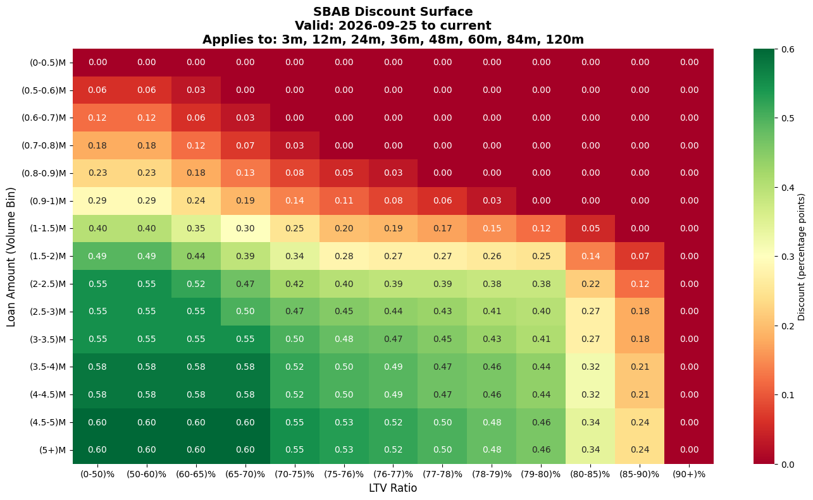

# SBAB Rate Monitor

Reference implementation of a daily monitor of SBAB's mortgage pricing, via SBAB's public API. It detects changes to list rates and discount structures, sends email alerts, and opens PRs when structural changes need human review. This repo is a public snapshot of my private deployment, which runs daily; here the schedule is commented out (in `.github/workflows/daily_scrape.yml`) so it doesn't duplicate those alerts, and the fast test suite runs on every push. To run it yourself, add the secrets listed under Setup and restore the `schedule:` trigger.



**What the data shows** (computed from `data/*.csv`):
- Six discount-surface regimes since 2022-09-26, with changes on 2025-04-28, 2025-12-10, 2026-02-17, 2026-03-31 and 2026-09-25.
- The maximum discount rose from 0.45 to 0.60 percentage points over that period.
- List rates changed 17 to 28 times per maturity over the same period.

**What this repo is.** The code and data use only SBAB's public prices; no employer data or internal systems are used or stored, and no personal data is collected or stored. Developed as a personal project with my employer's knowledge, and published with my manager's approval. Built with AI assistance (Claude Code) under explicit guardrails: working rules in `CLAUDE.md`, a pytest suite and review passes. See [How this was built](#how-this-was-built) and [Responsible use](#responsible-use).

## How It Works

In the deployment, a GitHub Actions workflow runs daily at 07:30 UTC:

1. **Light run** (~800 API calls, ~5 min): scrapes a minimal grid of (LTV, loan amount, maturity) combinations
2. **Compares** today's pricing against stored discount surfaces and list rates
3. **Sends email**: either a "no changes" heartbeat, a list rate change report, or a structural change alert
4. If the discount structure changed: **triggers a deep run** (~4,850 API calls, ~50 min), discovers new boundaries, validates, and opens a PR

### Pipeline Steps

```
Light run (always):
  1   Scrape minimal grid
  2   Detect list rate changes (updates list_rates.csv, commits to main if changed)
  3a  Compute discount = list_rate - offered_rate, bin by LTV/volume
  3b  Generate discount surface PNGs
  4   Check bin uniformity and discount values against stored surface
  5a  Classify email type (no_change / list_rate_change / deep_run_started)

Deep run (only if step 4 detects structural change):
  5b  Create feature branch
  6a  Scrape refined grid (finer probe spacing)
  6b-6i  Extract break lines, build bins, update CSVs and PNGs
  6j  Validate: re-run light scrape with new boundaries
  7   Open PR if validation passed

Always:
  8   Send email report
```

### Data Model

SBAB's pricing is captured with two small CSVs:

- **`data/list_rates.csv`** — base rates per maturity (the "sticker price" with zero discount)
- **`data/discount_surfaces.csv`** — discount patterns by LTV bin, volume bin, and maturity

Each row has `valid_from` and `valid_to` dates, giving a full temporal history. When pricing changes, old rows are closed and new rows are appended.

List rate = the highest offered rate for a maturity across the probe grid (the rate with zero discount). Rates and discounts are in percentage points (0.60 = 60 bp).

Discount surface heatmaps are stored in `data/visualizations/`.

**Data provenance.** Before 2025-12-27, the author collected SBAB's discount surfaces and list rates with earlier, manually run versions of this code (first extraction: 2022-09-26). The first surface (valid 2022-09-26 to 2025-04-27) is that single extraction, made with the author's 2022 scraper and re-checked regularly over the following years without a change being seen. Since 2025-12-27, collection has been automated by the code in this repository. The CSVs in `data/` combine both periods. List-rate intervals before 2025-12-27 are reconstructed: each rate is treated as valid until the last date it was seen, and the next rate starts the following day, so some of the earlier start dates are inferred.

## Setup

### GitHub Actions (primary)

1. Fork/clone this repo
2. Add GitHub Secrets (`Settings > Secrets > Actions`):
   ```
   SMTP_HOST = smtp.gmail.com
   SMTP_PORT = 587
   SMTP_USER = your-email@gmail.com
   SMTP_PASS = your-app-password (not your account password)
   TO_EMAIL = recipient@email.com
   ```
3. Enable Actions

For Gmail: enable 2FA, then create an App Password at https://myaccount.google.com/apppasswords

### Manual / Local

```bash
pip install -r requirements.txt
python src/aleph_null.py                          # production run
python src/aleph_null.py --force-shallow          # suppress deep runs
IS_TEST=true python src/aleph_null.py             # test mode (prefixes email subjects)
```

### Workflow Inputs

The workflow can be triggered manually with these options:

| Input | Description |
|-------|-------------|
| `send_email` | Send email notification (default: true) |
| `is_test` | Prepend TEST to email subjects (default: false) |
| `force_shallow` | Suppress deep runs, send diagnostic email instead (default: false) |
| `data_dir` | Override data directory with a fixture path, e.g. `data/test_fixtures/discount_surface_change/` (default: none). Automatically forces test-mode behavior regardless of `is_test` -- see `run_gh_tests.sh` under Testing below. |

## Repository Structure

```
.github/workflows/daily_scrape.yml   # GitHub Actions workflow
run_gh_tests.sh                       # Trigger deep-run test scenarios on GitHub Actions (see Testing)
src/                                  # Pipeline code
  aleph_null.py                       #   Orchestrator (entry point)
  1_scraper_run_on_minimal_grid.py    #   Step files (numbered by execution order)
  3a_convert_csv_to_nice_pd_df.py
  ...
  8_send_email_with_report.py
  io_contracts.py                     #   Schema validation and the central assumption registry (see note below)
  monitor_list_rate.py                #   Shared: list rate detection
  notify.py                           #   Shared: email sending
  redact_secrets.py                   #   Shared: scrub likely secrets from git/gh output before logging it
  boundaries_refined.yaml             #   Deep run probe grid
data/                                 # Version-controlled data
  discount_surfaces.csv               #   Discount patterns (temporal)
  list_rates.csv                      #   Base rates (temporal)
  boundaries_minimal.yaml             #   Light run probe grid (updated by deep runs)
  visualizations/                     #   Discount surface heatmaps
supplemental_data/                    # One-time historical backfill (not part of the pipeline, see below)
```

`supplemental_data/` holds a one-time script (`backfill.py`) and its source CSVs, used once to backfill `discount_surfaces.csv`/`list_rates.csv` with pricing history that predates this repo. Already run; kept for provenance/reference, not invoked by the pipeline or by any test.

Hardcoded constants (sentinels, thresholds, prominent boundaries, valid maturities, etc.) belong in `io_contracts.py`. One documented exception: `_DATA_FILES`, `_DISCOUNT_SURFACE_GLOB` and `_CHANGE_DESCRIPTIONS` in `src/7_open_PR_with_updates_to_main.py` stay local to that file -- they're PR-formatting details (which files step 7 stages and how it describes them), not assumptions about SBAB's pricing data, and have exactly one reader.

## Known TODOs

- **Shrink pytest probe region to speed up tests:**
    Tests don't need the full LTV/VOL grid — they're testing pipeline logic, not discovering SBAB boundaries. Restrict test fixtures and test-specific boundary configs to a smaller window (e.g., VOL 1.99–4.01M SEK, LTV 64.9–80.01%) and have the deep run probes in pytest use matching reduced configs. Would cut API calls dramatically and bring the full suite well under 40 min.

## Testing

The pipeline can be tested against modified reference CSVs using `--data-dir`. The pipeline hits the real SBAB API but compares against fixture data, triggering different code paths depending on the diff.

### Fixture scenarios

| Scenario | What it tests | Command |
|----------|--------------|---------|
| `discount_surface_change` | Deep run trigger (discounts scaled to 10% of real values) | `IS_TEST=true python3 src/aleph_null.py --data-dir data/test_fixtures/discount_surface_change/ --force-shallow` |
| `list_rate_change` | List rate detection (rates multiplied by 20x) | `IS_TEST=true python3 src/aleph_null.py --data-dir data/test_fixtures/list_rate_change/ --force-shallow` |
| `maturity_discovered` | New maturity (2nd shortest removed from fixtures) | `IS_TEST=true python3 src/aleph_null.py --data-dir data/test_fixtures/maturity_discovered/ --force-shallow` |
| `maturity_closed` | Removed maturity (fake prime-numbered maturity in fixtures) | `IS_TEST=true python3 src/aleph_null.py --data-dir data/test_fixtures/maturity_closed/ --force-shallow` |

Drop `--force-shallow` to test the full deep run path (~4,850 API calls). Emails and PRs created during test runs are prefixed with "DO NOT MERGE."

### Regenerating fixtures

```bash
python3 data/test_fixtures/generate_fixtures.py
```

Regenerate after merging a deep run PR (production CSVs changed → fixtures need updating).

### pytest

Integration tests that hit the real SBAB API and create real PRs (with "DO NOT MERGE" prefix), plus fast unit tests that mock everything. Cleanup is automatic.

```bash
# Fast unit tests (the default: pytest.ini excludes the live-API tests; about a second, no API calls, no PRs)
pytest tests/ -v

# Everything, including the live-API tests (hits SBAB's API and opens real PRs)
pytest tests/ -v -m ""

# Light-run tests only
pytest tests/ -v -m "slow and not very_slow"

# Single scenario
pytest tests/test_pipeline.py::test_maturity_discovered -v -m very_slow
```

Markers: `@slow` (light run) and `@very_slow` (deep run). Unmarked tests are the fast unit tests.

#### Timing

|  | Light run (~800 API calls) | Deep run (~4,850 API calls) | Full suite (1 light + 3 deep) |
|--|---|---|---|
| **Local (pytest)** | ~2 min | ~13 min | ~40 min |
| **GitHub Actions** | ~5 min | ~50 min | ~2.5 hours |

### GitHub Actions testing

Trigger the 3 deep-run scenarios on GitHub Actions (the `list_rate_change` scenario is excluded because it auto-commits fake list rates to the branch — test it locally via pytest instead):

```bash
./run_gh_tests.sh              # with test emails
./run_gh_tests.sh --no-email   # without emails
```

Runs on the current branch with `is_test=true`. Starts are staggered by 15s to avoid branch name collisions. Each deep-run scenario takes ~50 min and creates a "DO NOT MERGE" PR.

#### Convention: run pytest before merging to main

Before creating a PR to `main` that includes pipeline code changes (new steps, schema changes, maturity lifecycle, etc.), run the full pytest suite locally and confirm every test passes. This is a manual gate — not enforced by a hook — because the suite takes ~40 min and most PRs to main are auto-generated deep-run results that are already validated by step 6j.

## Responsible use

- The scraper reads SBAB's public, unauthenticated rate endpoint. No access controls are bypassed, and every request identifies itself with a descriptive `User-Agent`.
- A daily run makes about 800 sequential requests, a deep run about 4,850. `SCRAPER_PAUSE_SECONDS` in `src/io_contracts.py` adds a pause between requests (0 by default); anyone else running this should set a small positive value.
- SBAB's `robots.txt` does not disallow `/www-open-rest-api/` (checked 2026-10-08).
- Context: SBAB is owned by the Swedish state and, by parliamentary decision, is to contribute to diversity and competition in the Swedish mortgage market ([Riksdagen, Finansutskottets betänkande FiU39](https://data.riksdagen.se/dokument/GW01FiU39)).

## License

Code: MIT (see `LICENSE`). The CSVs and PNGs are derived from SBAB's public prices and provided without warranty. This project is not affiliated with SBAB.

## Design notes and trade-offs

- **The pipeline edits files in its own repo.** Normal operation appends rows to the CSVs and regenerates the PNGs. When a loan maturity appears or disappears it also rewrites the `VALID_MATURITIES` list in `src/io_contracts.py`, and on deep runs it injects a "regenerate fixtures" TODO into this README and `generate_fixtures.py`. Structural changes reach `main` only through a PR, after a re-scrape validates them.
- **List-rate changes are committed straight to `main`**, unreviewed, by the GitHub Actions run. They are low-risk bookkeeping, and they have to be on file before discounts can be computed correctly.
- **Runtime checks use `assert`**, so a bad input stops the run loudly. They would be skipped under `python -O`, which this project never uses.
- **One discount surface per validity period.** All maturities currently share the same surface; if SBAB ever prices maturities differently, the visualizations would need extending.
- **Request pattern:** a light run makes about 800 sequential requests a day and a deep run about 4,850 (4,070 on the refined grid plus a 780-request validation re-scrape), with no throttle beyond request latency by default. Failed requests are retried after a short delay, and every request identifies itself with a descriptive `User-Agent`.

## Known Limitations

- **GitHub Actions cron is unreliable.** Scheduled runs can be silently dropped with no trace in the queue — no failure, no delay, just absent. Observed on 2026-03-16 (Monday): the daily cron (then set to 08:25 UTC; now 07:30 UTC) simply didn't fire despite the workflow being active, the repo having recent commits, and 6 consecutive days of successful scheduled runs prior. GitHub does not document this well and provides no retry mechanism. Workaround: monitor for missing emails and trigger manually via `gh workflow run` or the Actions GUI. This is a strong argument for migrating to self-hosted infrastructure with a proper scheduler (e.g., cron on a server you control).

## Cost

$0 — GitHub Actions free tier + Gmail SMTP.

## How this was built

This is a personal project that I designed and operate. I use Claude Code (Anthropic's AI coding assistant) throughout, and I want that to be visible rather than implied.

- My role: I wrote the original scraper, in 2022, that serves as the foundation for this repo; I defined the pipeline structure in `aleph_null.py` and `io_contracts.py` to guard against code drift and bloat; I specifically designed the data-retention policy and format, visualizations and the alert-tree for various "discoveries"; I specified the changes in SBAB's pricing which the code looks for; and I verify behaviour against SBAB's live prices.
- Claude's role: Claude wrote most of the implementation and test code against that structure, and ran review passes. I review the diffs and decide what gets merged.
- My guardrails: the assistant's working rules are in `CLAUDE.md`, and a pytest suite protects the pipeline's daily output against regressions. I kept the repo deliberately lightweight, and the tests are a welcome safety net.

This public repo is a snapshot of a longer private development history, so it shows a single commit.
